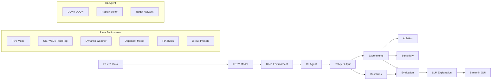

# ApexStrategy AI
## Reinforcement Learning-Based Formula 1 Pit Strategy Optimisation


---

## Overview

ApexStrategy AI learns Formula 1 pit strategy — when to pit and which tyre compound to select — under realistic, stochastic race conditions, and explains its decisions.

The system combines:

- Real F1 race data (FastF1, 2023 season)
- An LSTM sequence model for lap-time prediction
- A custom multi-car race simulator
- DQN / Double DQN reinforcement learning
- Safety Car, Virtual Safety Car, and Red Flag modelling
- Dynamic weather (dry / damp / wet) with compound-specific penalties
- A rule-based multi-car opponent model with undercut/traffic reward shaping
- 21 real-circuit presets for cross-circuit generalisation
- FIA tyre-rule enforcement
- Brute-force optimal baseline validation
- Ablation and sensitivity studies
- An LLM-based strategy explainer
- An interactive Streamlit GUI

The project started as deterministic single-car pit-stop optimisation and was progressively extended to adaptive strategy under realistic stochastic conditions.

---

## System Architecture



---

## Pipeline

```text
FastF1 Race Data
   ↓
LSTM Lap-Time Predictor
   ↓
Multi-Car Race Simulator (SC / VSC / Red Flag / Weather / Opponents / Circuits)
   ↓
DQN / DDQN Strategy Optimiser
   ↓
Brute-Force Baseline Comparison
   ↓
Experimental Analysis
   ↓
LLM Strategy Explanation
   ↓
Streamlit GUI
```

---

## Results

### Core Deterministic Results

| Strategy                  | Total Time (s) |
| -------------------------- | -------------- |
| No Pit                    | 5517.529       |
| Best 1-Stop (Brute Force) | 5160.714       |
| Best 2-Stop (Brute Force) | 5105.736       |
| **DQN Learned Policy**    | **5106.122**   |

The deterministic learned policy is within 0.386 seconds of the brute-force optimal 2-stop strategy.

### Safety Car Scenario

| Experiment               | Mean Time (s) | Std (s) | Mean Pits | SC Rate | Pitted Under SC |
| ------------------------ | ------------- | ------- | --------- | ------- | ---------------- |
| no_sc_train / no_sc_test | 5112.653      | 0.000   | 2.0       | 0.00    | 0.00              |
| sc_train / no_sc_test    | 5116.618      | 0.000   | 3.0       | 0.00    | 0.00              |
| no_sc_train / sc_test    | 5156.085      | 34.202  | 2.0       | 0.68    | 0.20              |
| sc_train / sc_test       | 5159.546      | 33.733  | 3.0       | 0.68    | **0.26**          |

The SC-aware policy pits under Safety Car more often, showing the agent learns to exploit reduced pit-loss windows.

### Algorithm Comparison

| Algorithm  | Total Time (s) |
| ---------- | -------------- |
| DQN        | 5106.169       |
| Double DQN | 5107.466       |

---

## Full Neutralisation Modelling

The simulator models the full range of F1 race neutralisations. Each event type has distinct lap-time and pit-cost effects, and multiple events can occur in a single race.

### Safety Car (SC)

| Parameter              | Default             |
| ---------------------- | -------------------- |
| SC probability per lap | 0.03                |
| Max SC events per race | 3                   |
| SC duration            | 2–5 laps            |
| Lap-time multiplier    | 1.20× (20% slower)  |
| Pit-loss multiplier    | 0.40× (60% cheaper) |

### Virtual Safety Car (VSC)

| Parameter               | Default             |
| ------------------------ | -------------------- |
| VSC probability per lap | 0.04                |
| VSC duration            | 2–4 laps            |
| Lap-time multiplier     | 1.10× (10% slower)  |
| Pit-loss multiplier     | 0.70× (30% cheaper) |

### Red Flag

| Parameter                    | Default |
| ----------------------------- | ------- |
| Red Flag probability per lap | 0.01    |
| Neutralisation duration      | 3 laps  |
| Free tyre change on restart  | `True`  |

Neutralisation logic: events are mutually exclusive (`Red Flag > SC > VSC` priority). Exclusion zones apply to laps 1–4 and the final 5 laps. All three event types are included in the 19-dimensional observation vector so the agent can condition decisions on the current neutralisation state.

---

## Weather & Dynamic Track Conditions

Weather evolves during the race via a Markov chain, introducing dry-to-wet transitions and strategic decisions on intermediate vs wet tyres.

### Weather states

| State  | Description                    |
| ------ | -------------------------------- |
| `dry`  | Slick compounds optimal         |
| `damp` | Intermediate compound optimal   |
| `wet`  | Full wet compound optimal       |

### Compound-weather penalties

| Weather | Compound      | Penalty (s/lap) |
| ------- | -------------- | ----------------- |
| dry     | INTERMEDIATE  | +3.0              |
| dry     | WET           | +8.0              |
| damp    | SOFT / MEDIUM | +5.0              |
| damp    | HARD          | +6.0              |
| wet     | SOFT / MEDIUM | +15.0             |
| wet     | HARD          | +16.0             |
| wet     | INTERMEDIATE  | +2.0              |

---

## Multi-Car Opponent Model

The simulator models N rule-based opponents with varied pit strategies and skill offsets, enabling the agent to learn positional racing strategy.

Each opponent follows a predetermined 1-stop or 2-stop plan, randomised at reset. Lap times are computed analytically with degradation, weather penalties, skill offsets, and noise. Opponents react to the same neutralisation events as the agent. Skill offsets are sampled in `[−1.5, +1.5]` s/lap.

| Situation                              | Reward effect                     |
| ---------------------------------------- | ------------------------------------ |
| Opponent within undercut window behind | Bonus proportional to closeness   |
| Stuck in traffic behind opponent       | Penalty proportional to closeness |

---

## Cross-Circuit Generalisation

The simulator supports 21 real F1 circuits via built-in presets. Setting `circuit_name` in `SimConfig` automatically loads the correct parameters.

```python
from config import SimConfig
cfg = SimConfig(circuit_name="monaco")
# → total_laps=78, base_lap_time=74.0, pit_loss_seconds=38.0, deg_k=14.0
```

| Circuit     | Laps | Base lap (s) | Pit loss (s) | deg_k |
| ----------- | ---- | ------------- | -------------- | ----- |
| bahrain     | 57   | 95.0          | 30.0           | 42.0  |
| jeddah      | 50   | 90.0          | 29.0           | 30.0  |
| melbourne   | 58   | 82.0          | 33.0           | 32.0  |
| baku        | 51   | 103.0         | 31.0           | 25.0  |
| miami       | 57   | 91.0          | 32.0           | 38.0  |
| monaco      | 78   | 74.0          | 38.0           | 14.0  |
| barcelona   | 66   | 80.0          | 31.0           | 40.0  |
| montreal    | 70   | 76.0          | 30.0           | 30.0  |
| silverstone | 52   | 90.0          | 31.0           | 33.0  |
| budapest    | 70   | 80.0          | 32.0           | 36.0  |
| spa         | 44   | 107.0         | 30.0           | 38.0  |
| zandvoort   | 72   | 75.0          | 33.0           | 37.0  |
| monza       | 53   | 82.0          | 27.0           | 45.0  |
| singapore   | 61   | 103.0         | 35.0           | 27.0  |
| suzuka      | 53   | 93.0          | 32.0           | 36.0  |
| losail      | 57   | 84.0          | 30.0           | 44.0  |
| austin      | 56   | 96.0          | 31.0           | 39.0  |
| mexico      | 71   | 79.0          | 30.0           | 28.0  |
| interlagos  | 71   | 73.0          | 30.0           | 34.0  |
| las_vegas   | 50   | 96.0          | 29.0           | 25.0  |
| abu_dhabi   | 58   | 87.0          | 29.0           | 33.0  |

`circuit_name="generic"` keeps manually specified parameters unchanged.

---

## System Components

### Data

Race telemetry collected using the FastF1 API (2023 season), exported to CSV and processed into sequence tensors of shape `(N, T, F)`.

### LSTM Lap-Time Model

```bash
python lstm/train_lstm.py
python lstm/predict_lstm.py
```

A sequence model trained in PyTorch using MSE loss that predicts lap-time behaviour from tyre age and compound history. Trained on dry-weather data only. For wet-weather compounds (`INTERMEDIATE`, `WET`), the LSTM contribution is zeroed and degradation is modelled analytically.

### Race Simulator

Multi-car environment with configurable race length, compound-specific tyre degradation, pit-loss penalties with neutralisation discounts, LSTM-based lap-time prediction, full SC / VSC / Red Flag neutralisation, dynamic weather, and a rule-based opponent model with gap tracking.

### Action Space

| Action | Meaning        |
| ------ | --------------- |
| 0      | Stay out        |
| 1      | Pit to SOFT     |
| 2      | Pit to MEDIUM   |
| 3      | Pit to HARD     |
| 4      | Pit to INTER    |
| 5      | Pit to WET      |

### State Vector (19-dimensional)

| Index | Feature               | Description                                 |
| ----- | ----------------------- | --------------------------------------------- |
| 0     | `lap_frac`             | Current lap / total laps                      |
| 1     | `laps_remaining_frac`  | Remaining laps / total laps                   |
| 2     | `tyre_life_norm`       | Tyre age / 60 (capped)                        |
| 3–7   | `compound_onehot`      | One-hot: SOFT, MEDIUM, HARD, INTER, WET       |
| 8     | `last_pred`            | Latest LSTM lap-time normalised prediction    |
| 9     | `slope`                | Degradation trend                             |
| 10    | `sc_active`            | Full Safety Car active flag                   |
| 11    | `sc_remaining_norm`    | SC laps remaining / SC max duration           |
| 12    | `vsc_active`           | Virtual Safety Car active flag                |
| 13    | `red_flag_active`      | Red Flag active flag                          |
| 14–16 | `weather_onehot`       | One-hot: dry, damp, wet                       |
| 17    | `gap_ahead_norm`       | Normalised gap to closest car ahead           |
| 18    | `gap_behind_norm`      | Normalised gap to closest car behind          |

### Reinforcement Learning

```bash
python -m rl.dqn_train
python -m rl.evaluate_dqn
```

Implements Deep Q-Networks and Double Deep Q-Networks with experience replay, target network stabilisation, epsilon-greedy exploration, reward shaping, best-model checkpointing, and seeded stochastic evaluation.

> Note on model compatibility: the observation space expanded from 10 to 19 dimensions in the current version. Previously trained `ddqn_*.pt` models with 10-dimensional input must be retrained.

### Baselines

```bash
python -m env.baselines
```

Brute-force search over no-pit, 1-stop legal, and 2-stop optimal strategies. The `wet_actions=True` flag extends the search to include `INTERMEDIATE` and `WET` compounds for weather-enabled scenarios.

### Visualisation

```bash
python scripts/plot_trace.py
python scripts/plot_results_clean.py
python scripts/plot_results_comparison.py
python scripts/plot_policy_map.py
python scripts/plot_policy_visited.py
python scripts/plot_time_saved.py
python scripts/plot_safety_car_compare.py
python scripts/plot_safety_car_trace.py
python scripts/plot_sc_sensitivity.py
```

### LLM Explanation

```bash
python -m explain.run_explainer
```

Structured explanation pipeline that extracts a race summary, passes it as JSON to an LLM, and constrains the explanation to strategy tokens and summary fields. Covers degradation reasoning, pit-loss trade-offs, neutralisation usage, weather-driven compound switches, and baseline comparison. Falls back to a deterministic explanation if no API key is available.

### GUI

```bash
streamlit run gui/app.py
```

Interactive Streamlit interface for running greedy DDQN evaluation, computing brute-force baselines, adjusting circuit and race parameters, enabling or disabling SC / VSC / Red Flag and weather, toggling opponent models, switching between model presets, and generating LLM strategy explanations.

---

## Experiments

### Algorithm Comparison
```bash
python scripts/run_ddqn_compare.py
```

### Ablation Study
```bash
python scripts/run_ablation.py
python scripts/plot_ablation.py
```
Tests: reward shaping removed, constraints removed, simplified environment.

### Sensitivity Analysis
```bash
python scripts/run_sensitivity.py
python scripts/plot_sensitivity.py
```
Parameters: pit loss, degradation rate, stint length, reward shaping, Safety Car probability.

### Safety Car Comparison
```bash
python -m scripts.run_safety_car_compare
python -m scripts.plot_safety_car_compare
python -m scripts.run_sc_sensitivity
python -m scripts.plot_sc_sensitivity
```

---

## Setup

### 1. Clone

```bash
git clone https://github.com/akinduwijesekera/apexstrategy-ai.git
cd apexstrategy-ai
```

### 2. Create and activate a virtual environment

```bash
python -m venv .venv
```

Mac/Linux: `source .venv/bin/activate`
Windows: `.venv\Scripts\activate`

### 3. Install dependencies

```bash
pip install -r requirements.txt
```

### 4. Environment variables

Create a `.env` file in the project root:

```env
OPENAI_API_KEY=your_api_key_here
```

If your explainer uses a different variable name, replace `OPENAI_API_KEY` accordingly.

### 5. Download race data

```bash
python data/download_race_laps_2023.py
```

### 6. Build the LSTM dataset

```bash
python data/build_lstm_dataset.py
```

### 7. Train the LSTM model

```bash
python lstm/train_lstm.py
```

---

## Running the full project end-to-end

```bash
# Download raw race data
python data/download_race_laps_2023.py

# Build dataset
python data/build_lstm_dataset.py

# Train LSTM
python lstm/train_lstm.py

# Train RL agent
python -m rl.dqn_train

# Evaluate agent
python -m rl.evaluate_dqn

# Compute baselines
python -m env.baselines

# Run experiments
python scripts/run_ddqn_compare.py
python scripts/run_ablation.py
python scripts/run_sensitivity.py
python -m scripts.run_safety_car_compare
python -m scripts.run_sc_sensitivity

# Generate plots
python scripts/plot_ablation.py
python scripts/plot_sensitivity.py
python scripts/plot_trace.py
python scripts/plot_results_clean.py
python scripts/plot_results_comparison.py
python scripts/plot_policy_map.py
python scripts/plot_policy_visited.py
python scripts/plot_time_saved.py
python scripts/plot_safety_car_compare.py
python scripts/plot_safety_car_trace.py
python scripts/plot_sc_sensitivity.py

# Run explanation module
python -m explain.run_explainer

# Launch GUI
streamlit run gui/app.py
```

---

## Repository structure

```text
data/
  build_lstm_dataset.py
  download_race_laps_2023.py
  processed/

env/
  race_env.py
  gym_race_env.py
  baselines.py

explain/
  llm_explain.py
  strategy_summary.py

gui/
  app.py

lstm/
  predict_lstm.py
  train_lstm.py

models/
  lstm_laptime_regressor.pt
  ddqn_no_sc_10d.pt
  ddqn_safety_car.pt
  ablation_*.pt

rl/
  dqn_train.py
  evaluate_dqn.py

scripts/
  plot_ablation.py
  plot_policy_map.py
  plot_policy_visited.py
  plot_results_clean.py
  plot_results_comparison.py
  plot_safety_car_compare.py
  plot_safety_car_trace.py
  plot_sc_sensitivity.py
  plot_sensitivity.py
  plot_time_saved.py
  plot_trace.py
  run_ablation.py
  run_ddqn_compare.py
  run_safety_car_compare.py
  run_sc_sensitivity.py
  run_sensitivity.py

utils/
  test_fastf1.py

config.py
requirements.txt
README.md
```

---

## Simplifications

This project intentionally simplifies several aspects of real-world Formula 1:

- Opponents are rule-based rather than RL agents
- Stochastic events are simulated rather than replayed directly from FastF1 event logs
- LSTM is trained on dry-weather data only
- No tyre blankets or tyre temperature warm-up model
- No fuel load effects
- No DRS zones or explicit overtaking mechanics
- No qualifying simulation
- No historical weather replay from FastF1

These simplifications keep the problem tractable while preserving the core strategic decision-making challenge.

---

## Contributions

- LSTM-based lap-time modelling
- Reinforcement learning strategy optimisation (DQN + DDQN)
- Full F1 neutralisation modelling (SC / VSC / Red Flag)
- Dynamic weather with compound-condition interaction
- Multi-car opponent modelling with gap-based reward shaping
- Cross-circuit generalisation via 21 parameterised circuit presets
- FIA tyre-rule integration and reward shaping
- Brute-force strategy validation
- Ablation and sensitivity analysis
- Policy and trace visualisation
- LLM-based interpretability
- Interactive deployment with Streamlit

---

## Team

Built as part of UCL's Introduction to Machine Learning coursework.

---

## Notes

- Make sure your `.env` file is not committed to GitHub
- Store trained models, cached data, and generated outputs in ignored directories
- If Streamlit or the explainer fails, check:
  - all dependencies are installed
  - `.env` exists and the API key is valid
  - trained model files have been generated
  - relative file paths are correct
  - `ddqn_*.pt` models were trained with the current 19-dimensional observation space

---

## Recommended `.gitignore` additions

```gitignore
.env
.venv/
__pycache__/
*.pyc
*.pyo
*.pyd
.ipynb_checkpoints/
models/*.pt
data/processed/
```
